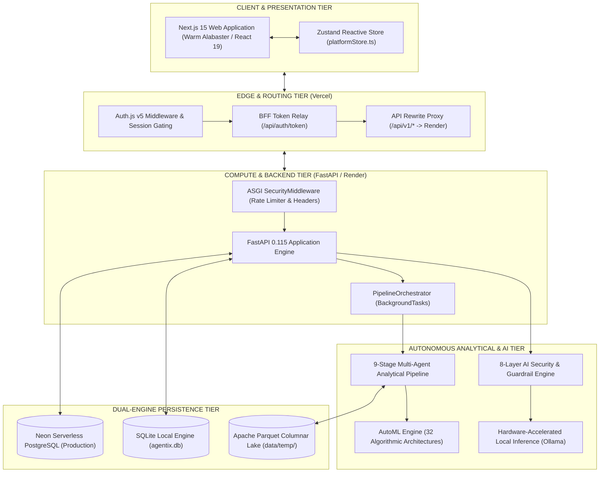
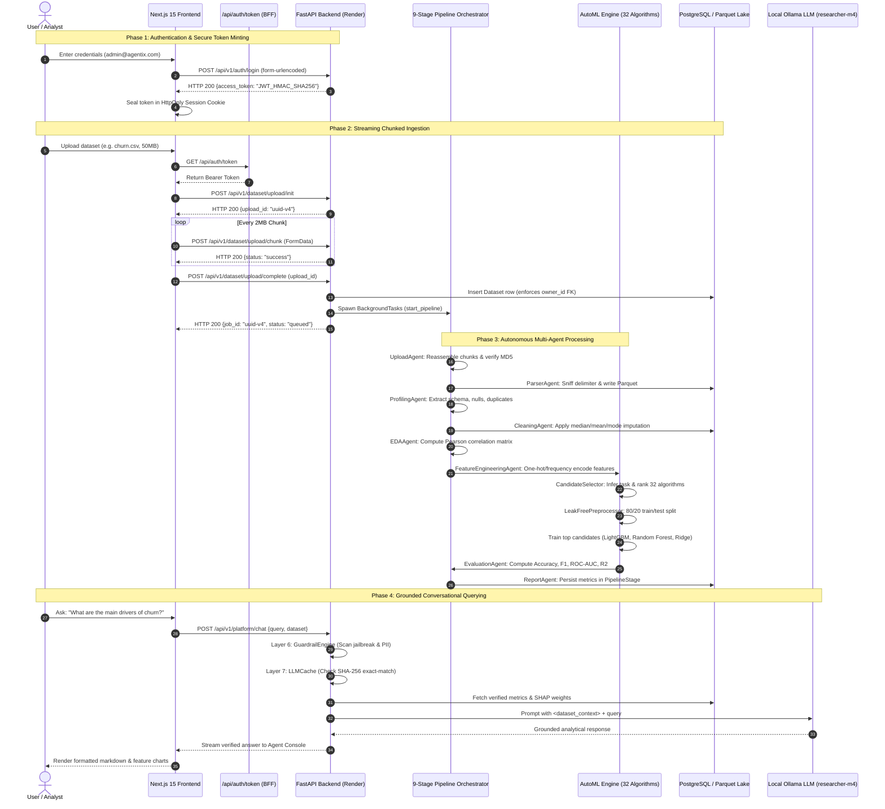
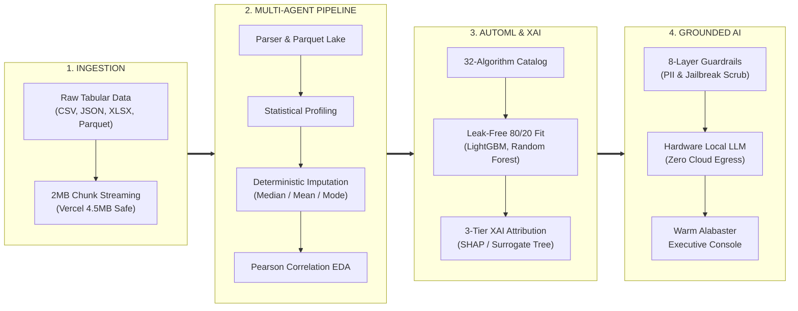

# AGENTIX: WORKFLOW DIAGRAM PACK & NARRATION GUIDE

**Academic Programme:** M.Sc. Data Science  
**Institution:** Department of Computer Science, CHRIST (Deemed to be University)  
**Presenter:** Thrilok M (Register No. 2548430)  
**Deliverable:** Presentation-Quality Editable Mermaid Architecture & Execution Diagrams  

---

## 1. Diagram 1: High-Level System Block Diagram

This block diagram provides an executive overview of the decoupled architectural tiers in Agentix:

---

## 2. Diagram 2: Detailed End-to-End Pipeline Execution Workflow

This sequence diagram depicts the exact chronological message flow from user upload through multi-agent processing, model fitting, and conversational querying:

---

## 3. Diagram 3: Compact Presentation-Ready Diagram

A streamlined, slide-optimized diagram emphasizing the linear transformation from Raw Data to Grounded Intelligence:

---

## 4. 60–90 Second Diagram Narration Script

**Target Time:** 75 Seconds  
**Context:** When presenting Slide 4 or Slide 8 during the CIA Evaluation.

> *"Please direct your attention to the central architecture diagram. Agentix is organized into four clean stages that guarantee zero data egress and zero statistical hallucination.*
>
> *First, at **Ingestion**, when a user drops a dataset—whether CSV, JSON, or an Excel workbook—the client streams it in 2-megabyte chunks. This deliberately bypasses serverless payload boundaries and streams directly into our Apache Parquet columnar data lake.*
>
> *Second, our **9-Stage Multi-Agent Pipeline** takes over asynchronously. The ParserAgent sniffs the dialect; the ProfilingAgent identifies nulls and duplicates; and the CleaningAgent uses statistical skewness to dynamically apply median, mean, or mode imputation.*
>
> *Third, our **AutoML Engine** queries the 32-algorithm registry. CandidateSelector infers the task, prepares a strict leak-free 80/20 split, and benchmarks models like LightGBM and Random Forest. Our 3-tier XAI resolver then extracts true mathematical feature attributions.*
>
> *Finally, at the **Intelligence Layer**, user queries pass through Layer 6 security guardrails—which neutralize prompt injections and redact PII—before querying a local, hardware-accelerated Ollama model. Because the verified pipeline metrics are injected directly into the context, the model cannot hallucinate.*
>
> *In summary: from raw file to verified model and grounded explanation, the entire lifecycle is automated, auditable, and air-gapped."*
