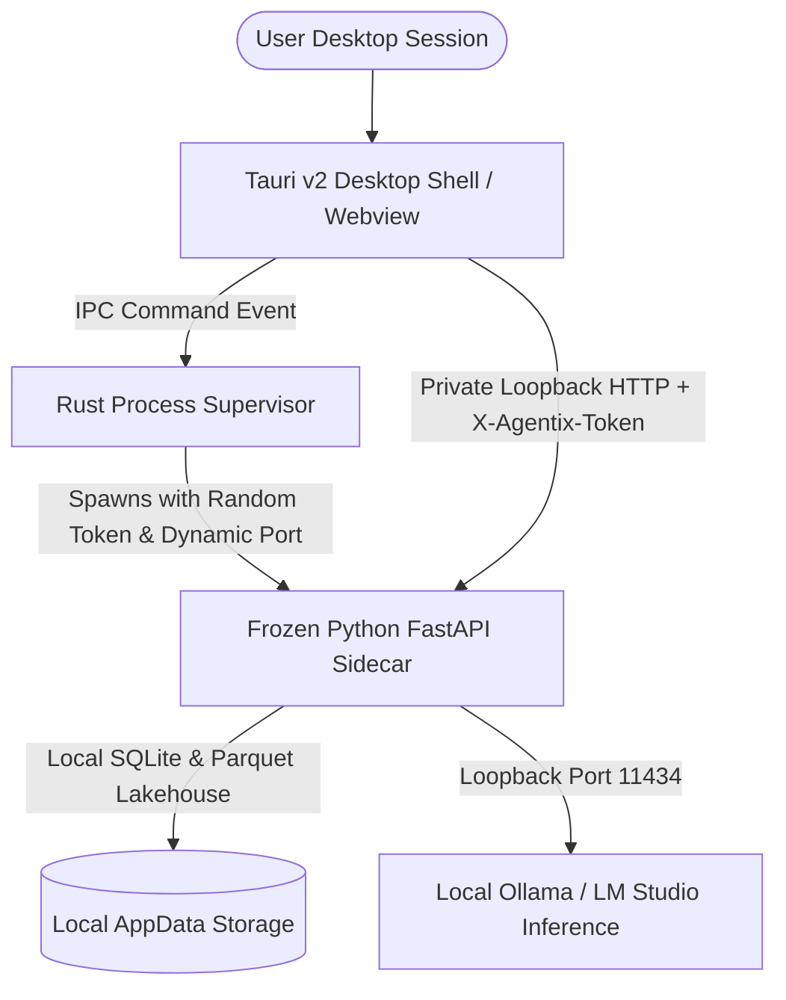

# Agentix Native Desktop Ecosystem

Welcome to the **Agentix Native Desktop Ecosystem** — a high-performance, cross-platform desktop application designed to run autonomous AI, Machine Learning, and Data Science workflows natively on **macOS** and **Windows** with 100% data sovereignty.

---

## 1. Executive Summary

While Agentix is available as a cloud-deployed web application (https://agentix-bay.vercel.app), the Native Desktop application eliminates cloud latency, eliminates third-party cloud data exposure, and takes full advantage of local hardware acceleration (Apple Silicon Metal, NVIDIA CUDA, DirectML).

---

## 2. Key Architecture Pillars

| Pillar | Desktop Implementation | Security & Performance Guarantee |
|---|---|---|
| **Shell & Webview** | Tauri v2 (Rust + WebKit / WebView2) | Minimal memory footprint (~40 MB shell vs ~400 MB Electron), native windowing |
| **Backend Engine** | PyInstaller standalone frozen binary | Self-contained Python 3.12 runtime with scikit-learn, Polars, FastAPI, PyArrow |
| **Process Supervision** | Rust async process manager | Dynamic ephemeral port assignment, automated handshake parsing, remote graceful shutdown |
| **Authentication Barrier** | High-entropy session token | Mandatory `X-Agentix-Token` HTTP header on non-public endpoints; blocks unauthorized local tabs |
| **Data Lakehouse** | Local SQLite & Parquet | Stored in `~/Library/Application Support/Agentix` or `%APPDATA%\Agentix`; zero cloud leakage |
| **Local Inference Link** | Ollama / LM Studio Loopback | Auto-discovery across ports 11434 and 1234; zero configuration required |

---

## 3. Platform Compatibility Matrix

| Operating System | Architecture | Package Format | GPU Acceleration | Status |
|---|---|---|---|---|
| **macOS 11+** | Apple Silicon (M1/M2/M3/M4) | `.dmg`, `.app` | Apple Metal, NEON | **Production Ready** |
| **macOS 11+** | Intel Core (x86_64) | `.dmg`, `.app` | CPU AVX2 | **Production Ready** |
| **Windows 10/11** | 64-bit (x86_64) | `.msi`, `.exe` (NSIS) | DirectML, CUDA | **Production Ready** |
| **Linux (All)** | x86_64 / aarch64 | Python Companion (`.py`) | Vulkan, CUDA | **Supported** |

---

## 4. Quickstart Guide

### Running Pre-Built Installers
1. **macOS**: Download `Agentix_1.0.0_aarch64.dmg`, open the disk image, and drag `Agentix.app` to `/Applications`.
2. **Windows**: Download `Agentix_1.0.0_x64_en-US.msi` and run the setup wizard.
3. Launch Agentix. The application automatically starts the local backend sidecar, checks for local Ollama models, and opens the studio dashboard.

---

## 5. Documentation Navigation

- [macOS Installation & Gatekeeper Guide](file:///Users/thrilokm/Downloads/agentix-recovery-backup-2026/INSTALLATION_MACOS.md)
- [Windows Installation & SmartScreen Guide](file:///Users/thrilokm/Downloads/agentix-recovery-backup-2026/INSTALLATION_WINDOWS.md)
- [Development Environment Setup](file:///Users/thrilokm/Downloads/agentix-recovery-backup-2026/DEVELOPMENT_SETUP.md)
- [Compilation & PyInstaller Build Guide](file:///Users/thrilokm/Downloads/agentix-recovery-backup-2026/BUILD_GUIDE.md)
- [Enterprise Release & Signing Guide](file:///Users/thrilokm/Downloads/agentix-recovery-backup-2026/RELEASE_GUIDE.md)
- [Troubleshooting & Diagnostics](file:///Users/thrilokm/Downloads/agentix-recovery-backup-2026/TROUBLESHOOTING.md)
