# Agentix — AI & Machine Learning Architecture

**Document Version: 2.4.0**  
**Classification: Evidence-Based AI Subsystem Specification**

---

## 1. Local AI Inference & Hardware Acceleration

Agentix rejects dependence on proprietary third-party cloud APIs for proprietary institutional data. Instead, it embeds local hardware-accelerated inference:

```mermaid
graph TD
    subgraph IngressQuery["Incoming User Query"]
        RawPrompt["Raw User Query (e.g. 'Explain risk outliers in Q3')"]
        TenantContext["Tenant Context & Role (e.g. Tenant: 'Acme-Corp', Role: 'Analyst')"]
    end

    subgraph Layer6Guardrails["Layer 6: Guardrails & Ingress Sanitization"]
        JailbreakScan["Adversarial Jailbreak Detection (Regex + Leetspeak + Base64)"]
        PIIRedaction["Bidirectional PII Redaction (SSN, Cards, Emails, API Keys)"]
        SanitizedPrompt["Sanitized & Filtered Prompt"]
        JailbreakScan --> PIIRedaction --> SanitizedPrompt
    end

    subgraph Layer7CacheRouting["Layer 7: Exact-Match Cache & Complexity Routing"]
        ExactCache{"Exact SHA-256 Cache Check (tenant + model + template + prompt)"}
        CacheHit["Cache Hit (<5ms) - Zero GPU/CPU Invocations"]
        ComplexityRouter["DynamicModelRouter (LIGHTWEIGHT vs BALANCED vs REASONING)"]
        ModelSelected["Optimal Model Selected (researcher-m4 or qwen2.5)"]
        
        ExactCache -->|HIT| CacheHit
        ExactCache -->|MISS| ComplexityRouter --> ModelSelected
    end

    subgraph Layer2And3Enclave["Layers 2 & 3: Prompt Enclave & Partitioned RAG"]
        VectorStore["Tenant-Partitioned Vector Store (128-dim Cosine Similarity)"]
        RetrievedPassages["Retrieved Verified Passages (Top-K Semantic Match)"]
        PromptRegistry["PromptRegistry (Versioned Template & Delimiter Enclave)"]
        HydratedPrompt["Hydrated Safe Context Prompt"]
        
        VectorStore --> RetrievedPassages
        RetrievedPassages --> PromptRegistry
        PromptRegistry --> HydratedPrompt
    end

    subgraph Layer4MCP["Layer 4: Governed MCP Tool Calling"]
        MCPRegistry["MCP Registry (JSON-RPC 2.0 Schemas)"]
        ToolAuth{"RBAC & Risk Tier Check (READ_ONLY, MUTATING, DESTRUCTIVE)"}
        ToolExec["Execute Tool Function"]
        ToolAudit["Audit Execution Log"]
        
        MCPRegistry --> ToolAuth
        ToolAuth -->|Authorized| ToolExec --> ToolAudit
    end

    subgraph InferenceExecution["Hardware Inference Execution"]
        OllamaLocal["Ollama Local Daemon (Apple Silicon / CUDA / Metal)"]
        ModelRun["Execute Model on Unified Memory (Zero Cloud Egress)"]
        RawOutput["Raw Model Analytical Output"]
        
        OllamaLocal --> ModelRun --> RawOutput
    end

    subgraph Layer8Evals["Layer 8: Observability & Automated Evaluations"]
        OutputScan["Output Safety Scan (Check for Credential / Prompt Leaks)"]
        FaithfulnessEval["AIEvaluator: Faithfulness Score (Grounded in Context)"]
        TelemetryTrace["OpenTelemetry Semantic Spans (Latency, Tokens, Cost)"]
        FinalDelivery["Final Verified Response Delivered to Frontend"]
        
        RawOutput --> OutputScan --> FaithfulnessEval --> TelemetryTrace --> FinalDelivery
    end

    RawPrompt --> Layer6Guardrails
    TenantContext --> Layer6Guardrails
    SanitizedPrompt --> Layer7CacheRouting
    ModelSelected --> Layer2And3Enclave
    HydratedPrompt --> InferenceExecution
    HydratedPrompt -.-> Layer4MCP
    ToolExec -.-> HydratedPrompt
```

---

## 2. Dynamic Model Complexity Routing

Inference requests are classified by the `DynamicModelRouter` ([model_router.py](file:///Users/thrilokm/Downloads/agentix-recovery-backup-2026/backend/core/services/model_router.py)) to optimize the tradeoff between latency and analytical depth:

- **`REASONING` Tier:**  
  - *Triggered by:* Complex keywords (`"why"`, `"cause"`, `"causal"`, `"evaluate"`, `"compare"`, `"tradeoff"`, `"derive"`, `"hypothesis"`) or analytical prompts longer than 60 words.
  - *Dispatched to:* High-parameter reasoning models (e.g. `researcher-m4:latest`, `deepseek-r1`, `llama3:8b`).
- **`LIGHTWEIGHT` Tier:**  
  - *Triggered by:* Short overview queries (< 10 words) without active dataset attachments.
  - *Dispatched to:* Compact low-latency models (e.g. `qwen2.5:3b`, `phi-3:mini`).
- **`BALANCED` Tier:**  
  - *Triggered by:* Standard data science questions, statistical summaries, and cleaning requests.
  - *Dispatched to:* Default balanced local models.

---

## 3. Sub-5ms Exact-Match SHA-256 Cache

To eliminate redundant GPU and CPU compute on identical queries, Agentix incorporates a thread-safe, tenant-partitioned exact-match inference cache ([llm_cache.py](file:///Users/thrilokm/Downloads/agentix-recovery-backup-2026/backend/core/cache/llm_cache.py)):

- **Key Generation:**  
  $$\text{Key} = \text{SHA-256}(\text{tenant\_id} : \text{model} : \text{template\_id} : \text{prompt})$$
- **Performance:** Exact-match hits return in **< 5 ms** with 0 GPU cycles consumed and 0 token generation latency.
- **Isolation:** Because `tenant_id` is prefixed into the hash seed, tenant A cannot retrieve or probe cached query responses generated by tenant B.

---

## 4. Tenant-Partitioned Vector RAG & Deterministic Embeddings

The Retrieval-Augmented Generation layer ([store.py](file:///Users/thrilokm/Downloads/agentix-recovery-backup-2026/backend/core/rag/store.py), [retriever.py](file:///Users/thrilokm/Downloads/agentix-recovery-backup-2026/backend/core/rag/retriever.py)) provides contextual ground-truth retrieval:

- **Deterministic Embedding Engine:** Uses token-hashed deterministic projection vectors (128 dimensions) normalized via $L2$ norm. This ensures rapid vector indexing without downloading gigabyte-scale embedding models or making external API calls.
- **Multi-Tenant Boundaries:** Vector stores are partitioned internally by `tenant_id`. Ingestion, chunk indexing, and similarity searches are strictly confined to the querying tenant's vector space.
- **Similarity Metric:** Computes cosine similarity between query and document vectors, filtering out irrelevant chunks below a cosine threshold of 0.15.

---

## 5. Model Context Protocol (MCP) Tool Sandboxing

Agentix implements a formal Model Context Protocol (MCP) registry ([registry.py](file:///Users/thrilokm/Downloads/agentix-recovery-backup-2026/backend/core/mcp/registry.py)) to give LLMs structured, safe operational capabilities:

| Tool Name | Risk Tier | Required Permission | Input Schema | Functionality |
| :--- | :--- | :--- | :--- | :--- |
| `get_dataset_profile` | `READ_ONLY` | `DATASET_READ` | `{"dataset_name": "string"}` | Retrieves column profiles, missing counts, and health scores. |
| `get_eda_correlations` | `READ_ONLY` | `DATASET_READ` | `{"dataset_name": "string"}` | Returns Pearson correlation matrix and distributions. |
| `clean_dataset` | `MUTATING` | `DATASET_WRITE` | `{"dataset_name": "string"}` | Triggers `CleaningAgent` with median/mode imputation. |
| `train_automl_model` | `DESTRUCTIVE`| `MODEL_TRAIN` | `{"dataset_name": "string"}` | Executes `TrainingAgent` on held-out split. |

Every tool invocation undergoes strict JSON-RPC 2.0 schema validation, RBAC permission verification, and audit logging recording execution duration and error details.

---

## 6. Automated Evaluations & Faithfulness Scoring

To protect institutional decision-makers from AI hallucination, Agentix includes an automated evaluation engine ([evaluator.py](file:///Users/thrilokm/Downloads/agentix-recovery-backup-2026/backend/core/evaluations/evaluator.py)):

- **Faithfulness Score ($0.0 - 1.0$):** Measures the proportion of key claim tokens in the generated answer supported by the retrieved pipeline context.
- **Answer Relevancy Score ($0.0 - 1.0$):** Evaluates whether the generated response directly answers the user's specific prompt tokens.
- **Context Recall Score ($0.0 - 1.0$):** Verifies that the retrieved context contained the necessary entities to answer the question.
- **Composite Grounding Formula:**
  $$\text{Composite Score} = 0.50 \times \text{Faithfulness} + 0.30 \times \text{Relevancy} + 0.20 \times \text{Context Recall}$$
- Responses with Composite Score $\ge 0.70$ are marked with the **Grounded** badge in the Agent Console.
