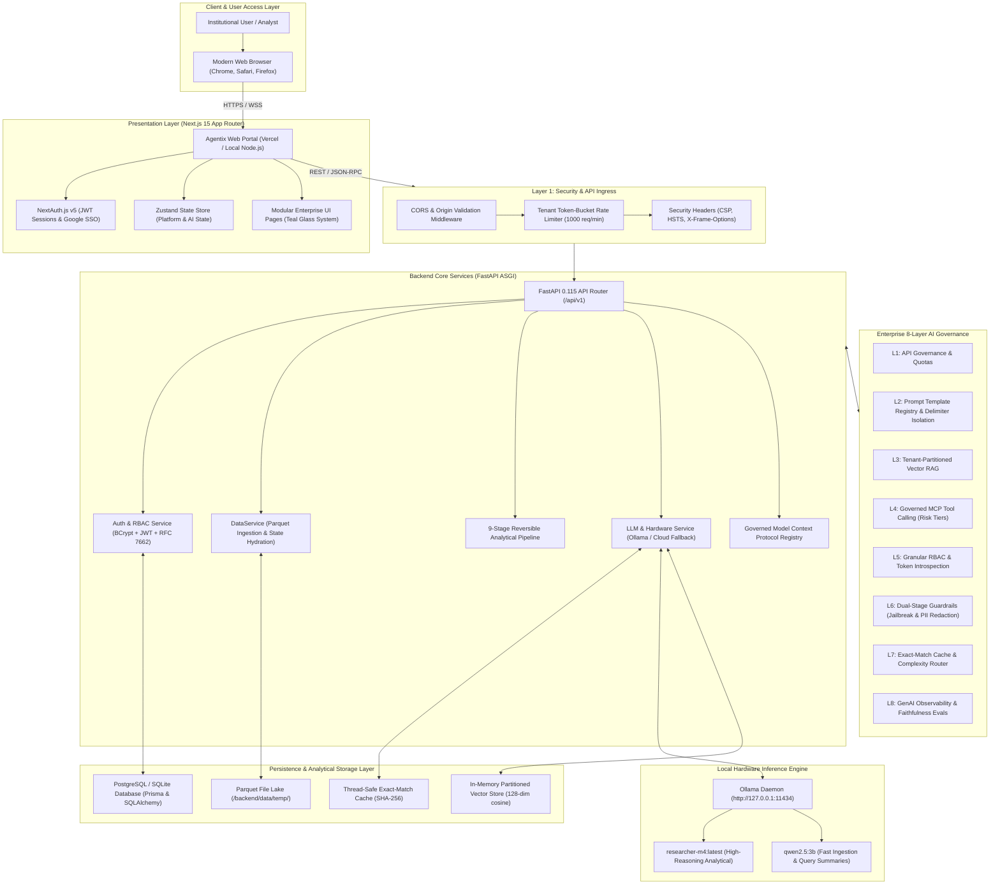
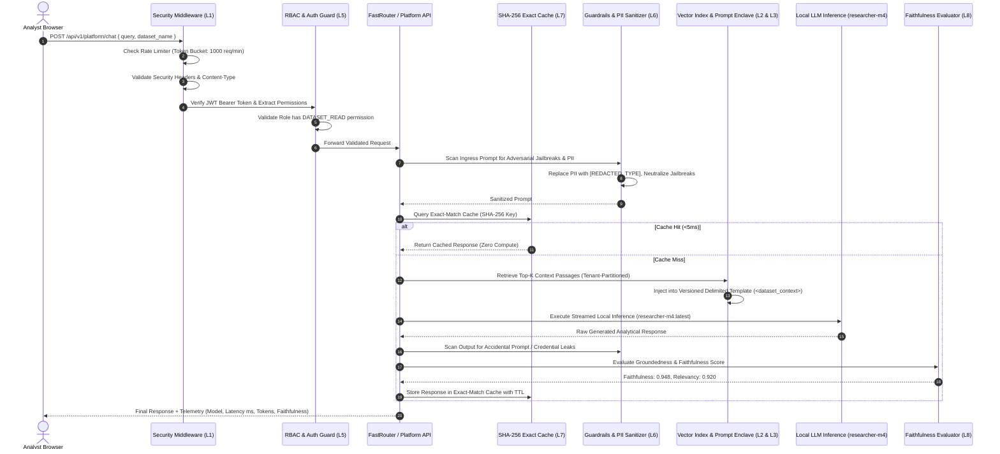

# Agentix — Architecture Documentation

**Document Version: 2.4.0**  
**Classification: Evidence-Based Architectural Specification**

---

## 1. System Architecture Overview

Agentix utilizes a decoupled, high-performance architecture composed of a **Next.js 15 App Router Frontend**, a **FastAPI Asynchronous Backend Engine**, a **Columnar Parquet Storage Lake**, an **Enterprise 8-Layer AI Governance Enclave**, and an **Air-Gapped Local Inference Daemon**.

---

## 2. Frontend Subsystem Architecture

The frontend is structured under Next.js 15's App Router paradigm:

- **Root Layout ([app/layout.tsx](file:///Users/thrilokm/Downloads/agentix-recovery-backup-2026/frontend/src/app/layout.tsx)):** Provides top-level HTML tags, sets up font variables, binds `SessionProvider` for Auth.js, and injects global CSS variables for theme management.
- **Application Shell ([app/(app)/layout.tsx](file:///Users/thrilokm/Downloads/agentix-recovery-backup-2026/frontend/src/app/(app)/layout.tsx)):** Enforces authentication gates, renders the collapsible left navigation sidebar, top navigation bar with active dataset pill, and real-time backend health monitor (`SystemHealth.tsx`).
- **Master Conversational AI Workspace ([app/(app)/agent-console/page.tsx](file:///Users/thrilokm/Downloads/agentix-recovery-backup-2026/frontend/src/app/(app)/agent-console/page.tsx)):**
  - **Thread Navigation Sidebar:** Date-grouped session history (*Today*, *Yesterday*, *Previous 7 Days*), session search filter, `⌘N` new thread shortcut.
  - **Message Stream:** Distinct user/assistant styling, formatted markdown (`react-markdown`), responsive tables, syntax-highlighted code blocks with copy button, and per-message execution telemetry badges.
  - **Anchored Composer:** Floating, multi-line auto-resizing input (`Enter` to submit, `Shift+Enter` for newline), paperclip attachment modal, Deep Reasoning toggle pill, and local hardware model switcher.

---

## 3. Backend Subsystem Architecture

The backend application is encapsulated in `backend/core/`:

- **Application Ingress ([main.py](file:///Users/thrilokm/Downloads/agentix-recovery-backup-2026/backend/core/main.py)):** Initializes FastAPI with metadata, mounts pure ASGI `SecurityMiddleware` and `ProfilingMiddleware`, registers routers, and initializes database tables.
- **API Router Layer ([api/v1/](file:///Users/thrilokm/Downloads/agentix-recovery-backup-2026/backend/core/api/v1/)):**
  - `routes_system.py`: Liveness, readiness, and telemetry probes.
  - `routes_auth.py`: User registration, login, token refresh, and RFC 7662 introspection.
  - `routes_data.py`: Multi-chunk dataset upload and validation.
  - `routes_jobs.py`: Asynchronous job status tracking with IDOR protection.
  - `routes_platform.py`: Core analytical services (profile, clean, fe, eda, automl, xai, chat, mcp).

---

## 4. End-to-End Request Lifecycle

