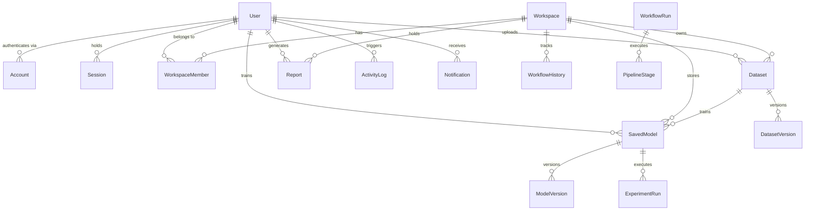

# Agentix — Database Architecture & Entity Schema

**Document Version: 2.4.0**  
**Classification: Verified Database Specification**

---

## 1. Database Architecture Overview

Agentix utilizes a dual-engine persistence pattern:

1. **Frontend / Enterprise SaaS Engine (Prisma ORM):**  
   Manages user authentication, OAuth accounts, active sessions, multi-tenant workspaces, team memberships, activity audit logs, and notification streams. Operates against **PostgreSQL** in production (Neon Postgres) with SQLite fallback in development.
2. **Backend Analytical State Engine (SQLAlchemy ORM):**  
   Manages user settings, dataset files, intermediate Parquet paths, workflow run states, individual pipeline stage metrics, and execution logs. Operates against SQLite / PostgreSQL.

---

## 2. Prisma Database Entities ([schema.prisma](file:///Users/thrilokm/Downloads/agentix-recovery-backup-2026/frontend/prisma/schema.prisma))

### `User`
- **Purpose:** Central identity record for all platform users.
- **Fields:**
  - `id` (String, PK, CUID): Unique user identifier.
  - `name` (String, Nullable): User display name.
  - `email` (String, Unique): Verified email address.
  - `emailVerified` (DateTime, Nullable): Verification timestamp.
  - `image` (String, Nullable): Avatar image URL.
  - `role` (String, Default: `"USER"`): Top-level platform role (`"ADMIN"`, `"USER"`).
  - `lastLogin` (DateTime, Nullable): Timestamp of most recent authentication.
  - `loginCount` (Int, Default: 0): Total login events.
  - `preferences` (Json, Nullable): User UI theme and notification configuration.
  - `createdAt` / `updatedAt` (DateTime): Audit timestamps.

### `Workspace` & `WorkspaceMember`
- **Purpose:** Enforces organizational and team multi-tenancy.
- **Fields (`Workspace`):**
  - `id` (String, PK, CUID): Unique workspace identifier.
  - `name` (String): Institutional workspace name.
  - `type` (String, Default: `"PERSONAL"`): `"PERSONAL"`, `"TEAM"`, `"ORGANIZATION"`.
  - `ownerId` (String): ID of creating user.
- **Fields (`WorkspaceMember`):**
  - `id` (String, PK): Membership record ID.
  - `workspaceId` (String, FK $\rightarrow$ `Workspace.id`): Associated workspace.
  - `userId` (String, FK $\rightarrow$ `User.id`): Associated user.
  - `role` (String, Default: `"VIEWER"`): Workspace RBAC role (`"ADMIN"`, `"EDITOR"`, `"VIEWER"`).
  - *Unique Constraint:* `@@unique([workspaceId, userId])` prevents duplicate memberships.

### `Dataset` & `DatasetVersion`
- **Purpose:** Tracks tabular data uploads, metadata, and version lineage.
- **Fields (`Dataset`):**
  - `id` (String, PK): Dataset identifier.
  - `userId` (String, FK $\rightarrow$ `User.id`): Owner.
  - `workspaceId` (String, FK $\rightarrow$ `Workspace.id`, Nullable): Institutional workspace.
  - `name` (String): Filename (e.g. `sales_q3.csv`).
  - `sizeBytes` (Int): Total file size on disk.
  - `rowCount` / `colCount` (Int, Nullable): Dimension metadata.
  - `storageUrl` (String): Internal file storage path.
  - `status` (String, Default: `"UPLOADED"`): `"UPLOADED"`, `"CLEANED"`, `"FE_COMPLETED"`.
- **Fields (`DatasetVersion`):**
  - `id` (String, PK): Version ID.
  - `datasetId` (String, FK $\rightarrow$ `Dataset.id`): Parent dataset.
  - `version` (Int, Default: 1): Monotonically increasing version number.
  - `changeSummary` (String, Nullable): Audit note describing changes (e.g. `"Cleaned dataset"`).

### `SavedModel`, `ModelVersion` & `ExperimentRun`
- **Purpose:** MLOps model registry tracking AutoML training artifacts, hyperparameter runs, and metrics.
- **Fields (`SavedModel`):**
  - `id` (String, PK): Model identifier.
  - `datasetId` (String): Source training dataset.
  - `name` (String): Model name (e.g. `sgd_regression_v1`).
  - `algorithm` (String): Underlying algorithm (e.g. `SGDRegressor`).
  - `accuracy` / `r2Score` (Float, Nullable): Primary performance metric.
  - `artifactUrl` (String, Nullable): Path to serialized model weights.
- **Fields (`ExperimentRun`):**
  - `parameters` (Json): Hyperparameters (learning rate, loss, penalty).
  - `metrics` (Json): Evaluation outputs (MAE, RMSE, R², Accuracy, F1).
  - `isBestModel` (Boolean, Default: false): Indicates champion model.

---

## 3. SQLAlchemy Database Entities ([models.py](file:///Users/thrilokm/Downloads/agentix-recovery-backup-2026/backend/core/models/models.py))

### `Dataset` (SQLAlchemy)
- **Table Name:** `datasets`
- **Persistence Purpose:** Persists intermediate pipeline state across backend process restarts.
- **Fields:**
  - `id` (String, PK, UUID): Unique identifier.
  - `name` (String, Index, Nullable: False): Dataset name.
  - `owner_id` (String, FK $\rightarrow$ `users.id`): Enforces tenant data isolation.
  - `filepath` (String): Raw file storage path.
  - `parquet_path` (String, Nullable): Path to current active Parquet file.
  - `target_column` (String, Nullable): Locked prediction target variable name.
  - `problem_type` (String, Nullable): `"regression"` or `"classification"`.
  - `y_test_json` / `y_pred_json` (Text, Nullable): Serialized held-out predictions for EvaluationAgent.

### `WorkflowRun` & `PipelineStage`
- **Table Names:** `workflow_runs`, `pipeline_stages`
- **Persistence Purpose:** Detailed execution audit trail for the 9-stage analytical pipeline.
- **Fields (`PipelineStage`):**
  - `id` (String, PK, UUID): Stage execution ID.
  - `run_id` (String, FK $\rightarrow$ `workflow_runs.id`): Parent workflow run.
  - `agent_name` (String): Name of executing agent (e.g. `CleaningAgent`).
  - `step_order` (Integer): Order in pipeline (1 through 9).
  - `status` (String, Default: `"pending"`): `"pending"`, `"running"`, `"completed"`, `"failed"`.
  - `execution_time` (Float): Duration in seconds.
  - `memory_usage_mb` (Float): Peak memory consumption during stage.
  - `output_data` (Text, JSON): Serialized stage results and imputation details.
  - `errors` / `warnings` / `recommendations` (Text, JSON): Actionable stage diagnostic metadata.
