# Agentix — The Eight-Layer Enterprise AI Security Audit

**Document Version: 2.4.0**  
**Classification: Evidence-Based Security Audit & Compliance Matrix**

---

## 1. The Eight-Layer AI Governance Architecture

Agentix implements a comprehensive, defense-in-depth security model specifically tailored for enterprise and institutional AI deployments:

```mermaid
graph TD
    subgraph L1["Layer 1: API Governance & Ingress Protection"]
        T1["Tenant Token-Bucket Rate Limiter (1000 req/min)"]
        T2["Strict Security Headers (CSP, HSTS, X-Frame-Options: DENY)"]
        T3["Payload Size & JSON Content-Type Constraints"]
    end

    subgraph L2["Layer 2: System Prompt Management & Enclaves"]
        P1["Versioned Prompt Template Registry (core/prompts/registry.py)"]
        P2["Cryptographic SHA-256 Template Integrity Check"]
        P3["Structural Delimiter Enclaves (<dataset_context>, <untrusted_user_query>)"]
    end

    subgraph L3["Layer 3: Retrieval-Augmented Generation (RAG) Security"]
        R1["Tenant-Partitioned Vector Indexing (Zero Cross-Tenant Retrieval)"]
        R2["Cosine Similarity Relevance Thresholding (Filter Irrelevant Chunks)"]
        R3["Deterministic Local Token Embeddings (Zero Cloud Data Egress)"]
    end

    subgraph L4["Layer 4: MCP Tool Governance & Sandboxing"]
        M1["Formal JSON-RPC 2.0 Input Schema Validation"]
        M2["Three-Tier Risk Categorization (READ_ONLY, MUTATING, DESTRUCTIVE)"]
        M3["Granular Tool Execution Audit Logs (Timestamp, User, Duration)"]
    end

    subgraph L5["Layer 5: Granular RBAC & OAuth 2.0 / OIDC"]
        A1["Role Matrix: Admin, Data Scientist, Analyst, Viewer"]
        A2["RFC 7662 Token Introspection Endpoint (/oauth/introspect)"]
        A3["Mass-Assignment Protection on Registration (Strict User Role Lock)"]
    end

    subgraph L6["Layer 6: AI Guardrails & Dual-Stage Sanitization"]
        G1["Adversarial Jailbreak Neutralization (Regex, Leetspeak, Base64 Obfuscation)"]
        G2["Bidirectional PII Redaction (SSN, Credit Cards, Emails, API Keys)"]
        G3["Output Leakage Prevention (Blocks System Prompt & Secret Dumps)"]
    end

    subgraph L7["Layer 7: Intelligent Model Routing & Caching"]
        C1["Thread-Safe Exact-Match Cache (SHA-256 Key: Tenant:Model:Template:Prompt)"]
        C2["Sub-5ms Cache Response (100% Compute & Energy Elimination)"]
        C3["Dynamic Complexity Router (LIGHTWEIGHT, BALANCED, REASONING)"]
    end

    subgraph L8["Layer 8: Observability & Automated Evaluations"]
        O1["Automated Factual Faithfulness Scoring (0.0 - 1.0 Against Context)"]
        O2["Relevancy & Context Recall Metrics"]
        O3["OpenTelemetry Semantic Spans (Latency, Tokens, Hardware Usage)"]
    end

    L1 --> L2
    L2 --> L3
    L3 --> L4
    L4 --> L5
    L5 --> L6
    L6 --> L7
    L7 --> L8
```

---

## 2. Layer-by-Layer Evidence & Verification Audit

### Layer 1: API Governance & Ingress Protection
- **Intended Purpose:** Prevent denial-of-service (DoS), resource exhaustion, and MIME-sniffing attacks; enforce tenant-level rate quotas.
- **Actual Implementation:** [backend/core/middleware/security.py](file:///Users/thrilokm/Downloads/agentix-recovery-backup-2026/backend/core/middleware/security.py) implements `TenantTokenBucketLimiter` with capacity of 1,000 tokens per tenant (refilling at 16.67 tokens/sec = 1,000 req/min) and injects HTTP security headers:
  - `Content-Security-Policy: default-src 'self'`
  - `X-Frame-Options: DENY`
  - `X-Content-Type-Options: nosniff`
  - `Strict-Transport-Security: max-age=31536000; includeSubDomains`
- **Verification Test:** `tests/test_enterprise_layers.py::test_layer1_token_bucket_limiter` (**PASSED**).

### Layer 2: System Prompt Management & Enclaves
- **Intended Purpose:** Prevent prompt injection, system prompt leakage, and delimiter collision by isolating untrusted user input from system directives.
- **Actual Implementation:** [backend/core/prompts/registry.py](file:///Users/thrilokm/Downloads/agentix-recovery-backup-2026/backend/core/prompts/registry.py) defines `PromptRegistry` containing versioned templates (`analyst_core`, `analyst_rag`, `evaluator_faithfulness`). Each template computes a cryptographic `sha256_hash` of its structure and encapsulates user variables within explicit structural tags (`<untrusted_user_query>`, `<dataset_context>`). Delimiter collisions (`</untrusted_user_query>`) are sanitized.
- **Verification Test:** `tests/test_enterprise_layers.py::test_layer2_prompt_registry_hashing` (**PASSED**).

### Layer 3: Retrieval-Augmented Generation (RAG) Security
- **Intended Purpose:** Ensure that context retrieved during semantic search cannot bridge tenant boundaries or inject irrelevant hallucinated content.
- **Actual Implementation:** [backend/core/rag/store.py](file:///Users/thrilokm/Downloads/agentix-recovery-backup-2026/backend/core/rag/store.py) implements `TenantVectorStore`. All document insertions and queries require a `tenant_id` argument; vector lookups query exclusively within `self._stores[tenant_id]`. Chunks are scored via cosine similarity and filtered against a relevance threshold.
- **Verification Test:** `tests/test_enterprise_layers.py::test_layer3_tenant_vector_isolation` (**PASSED**).

### Layer 4: MCP Tool Governance & Sandboxing
- **Intended Purpose:** Prevent unauthorized or unvalidated tool execution by AI agents.
- **Actual Implementation:** [backend/core/mcp/registry.py](file:///Users/thrilokm/Downloads/agentix-recovery-backup-2026/backend/core/mcp/registry.py) enforces JSON-RPC 2.0 schemas on all tools. Tools are assigned one of three risk tiers (`READ_ONLY`, `MUTATING`, `DESTRUCTIVE`) and bound to required permissions (`DATASET_READ`, `DATASET_WRITE`, `MODEL_TRAIN`). Executions are recorded in `ToolExecutionAudit` with duration, caller ID, and status.
- **Verification Test:** `tests/test_enterprise_layers.py::test_layer4_mcp_risk_tiers_and_validation` (**PASSED**).

### Layer 5: Granular RBAC & OAuth 2.0 / OIDC
- **Intended Purpose:** Ensure strict privilege separation and enable federated identity verification.
- **Actual Implementation:** [backend/core/auth/rbac.py](file:///Users/thrilokm/Downloads/agentix-recovery-backup-2026/backend/core/auth/rbac.py) and [backend/core/api/v1/routes_auth.py](file:///Users/thrilokm/Downloads/agentix-recovery-backup-2026/backend/core/api/v1/routes_auth.py) implement 4 distinct roles (`admin`, `data_scientist`, `analyst`, `viewer`). User registration strictly enforces `role = "user"` to prevent mass-assignment privilege escalation. Exposes an RFC 7662-compliant token introspection endpoint (`POST /api/v1/auth/oauth/introspect`).
- **Verification Test:** `tests/test_enterprise_layers.py::test_layer5_oauth_token_introspection` (**PASSED**).

### Layer 6: AI Guardrails, Jailbreak Neutralization & PII Redaction
- **Intended Purpose:** Protect against adversarial prompt injection, base64-obfuscated jailbreaks, and PII leakage.
- **Actual Implementation:** [backend/core/guardrails/engine.py](file:///Users/thrilokm/Downloads/agentix-recovery-backup-2026/backend/core/guardrails/engine.py) evaluates incoming prompts against regex and leetspeak jailbreak signatures (`ignore previous instructions`, `DAN`, `ChatML delimiter injection`). Inspects base64 strings and decodes them to check for obfuscated injection attempts. Scans for PII (SSNs, credit cards, emails, phone numbers, API keys) and replaces them with `[REDACTED_<TYPE>]`. Scans output responses to prevent system prompt leakage.
- **Verification Test:** `tests/test_enterprise_layers.py::test_layer6_guardrail_jailbreak_neutralization` (**PASSED**).

### Layer 7: Intelligent Model Routing & Caching
- **Intended Purpose:** Prevent wallet exhaustion and reduce latency by dynamically routing queries and serving cached responses.
- **Actual Implementation:** [backend/core/cache/llm_cache.py](file:///Users/thrilokm/Downloads/agentix-recovery-backup-2026/backend/core/cache/llm_cache.py) implements thread-safe exact-match caching with composite keys (`SHA-256(tenant:model:template:prompt)`). [backend/core/services/model_router.py](file:///Users/thrilokm/Downloads/agentix-recovery-backup-2026/backend/core/services/model_router.py) classifies query complexity into `LIGHTWEIGHT`, `BALANCED`, or `REASONING` to select the optimal model.
- **Verification Test:** `tests/test_enterprise_layers.py::test_layer7_exact_match_cache_hit` (**PASSED**).

### Layer 8: Observability & Automated Evaluations
- **Intended Purpose:** Provide continuous telemetry on model performance, latency, token throughput, and factual accuracy.
- **Actual Implementation:** [backend/core/evaluations/evaluator.py](file:///Users/thrilokm/Downloads/agentix-recovery-backup-2026/backend/core/evaluations/evaluator.py) computes factual grounding via `evaluate_faithfulness()` and `evaluate_relevancy()`, returning a composite score. [backend/core/telemetry.py](file:///Users/thrilokm/Downloads/agentix-recovery-backup-2026/backend/core/telemetry.py) instruments requests with execution durations and memory utilization.
- **Verification Test:** `tests/test_enterprise_layers.py::test_layer8_faithfulness_evaluation` (**PASSED**).

---

## 3. Compliance Matrix & Verification Evidence

| Layer | Implemented Component | Key Source Files | Security Gaps / Limitations | Risk Level | Status |
| :--- | :--- | :--- | :--- | :--- | :--- |
| **L1** | Tenant Token Bucket & Security Headers | `core/middleware/security.py` | In-memory limiter resets upon backend worker restart. | Low | **Implemented & Verified** |
| **L2** | Prompt Enclave & SHA-256 Hashes | `core/prompts/registry.py` | Templates currently stored in Python memory rather than database. | Low | **Implemented & Verified** |
| **L3** | Tenant-Isolated Vector RAG | `core/rag/store.py` | Deterministic embeddings lack deep semantic nuance of neural embeddings. | Medium | **Implemented & Verified** |
| **L4** | Governed MCP Risk Tiers | `core/mcp/registry.py` | Tool audit logs held in process memory; persistent DB sink recommended. | Medium | **Implemented & Verified** |
| **L5** | Granular RBAC & RFC 7662 OIDC | `core/auth/rbac.py`, `routes_auth.py` | Full OAuth 2.0 PKCE client flow relies on external provider callbacks. | Low | **Implemented & Verified** |
| **L6** | Dual-Stage Guardrails & PII | `core/guardrails/engine.py` | Regex PII detection does not cover non-standard international IDs. | Medium | **Implemented & Verified** |
| **L7** | Exact Cache & Complexity Routing | `core/cache/llm_cache.py`, `model_router.py` | Exact-match requires identical prompt string; semantic cache planned. | Low | **Implemented & Verified** |
| **L8** | Faithfulness Scoring & Evals | `core/evaluations/evaluator.py` | Token-overlap faithfulness is heuristic; cross-encoder scoring planned. | Low | **Implemented & Verified** |

---

## 4. Architectural Security vs. Formal Certification

> **Important Distinction:**  
> The 8-layer architecture documented above represents **substantive defensive engineering controls** implemented directly in the Agentix source code and verified via automated test suites. However, this does not constitute independent, third-party certification (e.g. SOC 2 Type II, ISO 27001, or FedRAMP Authorization to Operate). Production institutional deployments must undergo external third-party penetration testing and formal compliance attestation.
