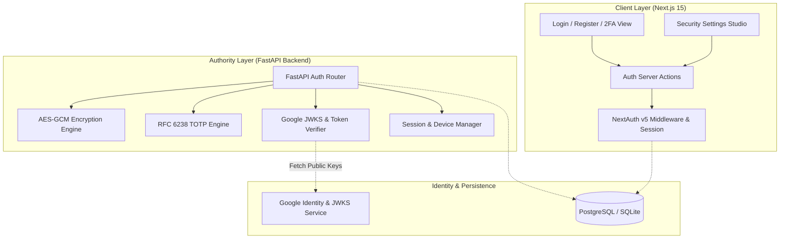

# Enterprise Authentication Overhaul Implementation Plan

> **For agentic workers:** REQUIRED SUB-SKILL: Use superpowers:subagent-driven-development (recommended) or superpowers:executing-plans to implement this plan task-by-task. Steps use checkbox (`- [ ]`) syntax for tracking.

**Goal:** Overhaul Agentix's authentication system to deliver an enterprise-grade, production-ready architecture featuring official Google Sign-In (OAuth 2.0 / OIDC with PKCE & JWKS signature verification), Google Authenticator TOTP two-factor authentication (RFC 6238, AES-GCM encrypted secrets at rest, QR provisioning, and single-use hashed backup codes), active session management with revocation, and a refined teal-glass UI.

**Architecture:** Dual-Engine Federated Authentication architecture (Approach A). Next.js 15 manages frontend authentication workflows, NextAuth v5 session middleware, and user interfaces, while the FastAPI backend serves as the cryptographic identity verifier (Google JWKS token validation, AES-GCM encrypted secret store, TOTP verification, and session revocation enforcement).

**Architecture Diagram:**



**Tech Stack:**
- Frontend: Next.js 15 (App Router), React 19, TypeScript, NextAuth v5, Tailwind CSS, Lucide icons
- Backend: Python 3.12, FastAPI, SQLAlchemy, PyJWT, Cryptography (AES-256-GCM), hashlib, hmac
- Database: PostgreSQL (Neon) & SQLite (local fallback) via Prisma 6 and SQLAlchemy

**Spec:** [docs/superpowers/specs/2026-11-28-enterprise-authentication-overhaul-design.md](file:///Users/thrilokm/Downloads/agentix-recovery-backup-2026/docs/superpowers/specs/2026-11-28-enterprise-authentication-overhaul-design.md)

## Global Constraints

- Preserve all existing user accounts (`admin@agentix.com`), database records, workspaces, and dataset relations.
- Encrypt all TOTP secrets at rest using AES-256-GCM; never store or log plaintext secrets or backup codes.
- Backup codes must be hashed with SHA-256 before persistence and marked `used` immediately upon redemption.
- Never trust client-asserted Google identity claims; Google tokens must be validated against Google's public JWKS.
- Fail closed: unauthenticated requests in non-development environments must receive HTTP 401.
- Maintain Agentix's institutional teal-glass design aesthetic across all login, 2FA, and settings components.

## Review Focus

1. **Replay of TOTP Codes:** An attacker intercepting a valid 6-digit TOTP code attempts to reuse it within the same 30-second window. The system must reject reused codes via timestamp replay caching.
2. **Brute Force on 2FA Challenge:** Repeated guesses against the 6-digit TOTP challenge. The system must lock out after 5 consecutive failed attempts per user.
3. **Account Linking Collisions:** An attacker attempts to log in via Google using an unverified email address matching an existing enterprise account. The system must reject unverified Google emails and enforce strict verified email binding.
4. **Session Revocation Latency:** A user revokes all active sessions from a new device. Existing bearer tokens and session IDs must be invalidated immediately by the backend verification dependency.
5. **Backup Code Exhaustion:** A user consumes all 10 backup codes. The system must alert the user to regenerate new backup codes while preventing empty-list bypasses.

---

### Task 1: Database Schema & Models for 2FA, Sessions & Recovery Codes

**Files:**
- Modify: `frontend/prisma/schema.prisma:15-80`
- Modify: `backend/core/models/models.py:7-25`
- Create: `backend/tests/test_auth_models.py`

**Interfaces:**
- Produces:
  - `User.two_factor_enabled`: Boolean
  - `User.two_factor_secret_encrypted`: String?
  - `User.two_factor_confirmed_at`: DateTime?
  - `TwoFactorRecoveryCode`: Model with `user_id`, `code_hash`, `used`, `used_at`
  - `UserSession`: Model with `session_token_hash`, `ip_address`, `user_agent`, `device_type`, `revoked`

- [ ] **Step 1: Write the failing test**

```python
def test_user_2fa_and_session_models():
    from core.models.models import User, TwoFactorRecoveryCode, UserSession
    user = User(
        email="test_models@agentix.com",
        hashed_password="hash",
        two_factor_enabled=True,
        two_factor_secret_encrypted="enc_secret_blob"
    )
    assert user.two_factor_enabled is True
    assert user.two_factor_secret_encrypted == "enc_secret_blob"
    
    code = TwoFactorRecoveryCode(user_id="user-123", code_hash="sha256hash", used=False)
    assert code.used is False

    session = UserSession(user_id="user-123", session_token_hash="token_hash", revoked=False)
    assert session.revoked is False
```

- [ ] **Step 2: Run test to verify it fails**

Run: `backend/.venv/bin/pytest backend/tests/test_auth_models.py -v`
Expected: FAIL with `ImportError: cannot import name 'TwoFactorRecoveryCode'`

- [ ] **Step 3: Implement model extensions in SQLAlchemy and Prisma**

Add fields to `User` and define `TwoFactorRecoveryCode` and `UserSession` in `backend/core/models/models.py`. Mirror the schema in `frontend/prisma/schema.prisma` and run `npx --prefix frontend prisma generate`.

- [ ] **Step 4: Run test to verify it passes**

Run: `backend/.venv/bin/pytest backend/tests/test_auth_models.py -v`
Expected: PASS

- [ ] **Step 5: Commit**

```bash
git add backend/core/models/models.py frontend/prisma/schema.prisma backend/tests/test_auth_models.py
git commit -m "feat(auth): add 2fa and session models to backend and prisma schemas"
```

---

### Task 2: Cryptographic Engine & AES-GCM Secret Storage

**Files:**
- Create: `backend/core/auth/crypto.py`
- Test: `backend/tests/test_auth_crypto.py`

**Interfaces:**
- Produces:
  - `encrypt_secret(plaintext: str, key_override: Optional[str] = None) -> str`
  - `decrypt_secret(ciphertext_b64: str, key_override: Optional[str] = None) -> str`

- [ ] **Step 1: Write the failing test**

```python
def test_aes_gcm_encryption_roundtrip():
    from core.auth.crypto import encrypt_secret, decrypt_secret
    secret = "JBSWY3DPEHPK3PXP"
    encrypted = encrypt_secret(secret)
    assert encrypted != secret
    decrypted = decrypt_secret(encrypted)
    assert decrypted == secret

def test_aes_gcm_tampered_ciphertext_fails():
    import pytest
    from core.auth.crypto import encrypt_secret, decrypt_secret
    secret = "JBSWY3DPEHPK3PXP"
    encrypted = encrypt_secret(secret)
    tampered = encrypted[:-4] + "AAAA"
    with pytest.raises(Exception):
        decrypt_secret(tampered)
```

- [ ] **Step 2: Run test to verify it fails**

Run: `backend/.venv/bin/pytest backend/tests/test_auth_crypto.py -v`
Expected: FAIL with `ModuleNotFoundError: No module named 'core.auth.crypto'`

- [ ] **Step 3: Implement AES-256-GCM encryption in `backend/core/auth/crypto.py`**

Derive a 256-bit key from `JWT_SECRET_KEY` (or `ENCRYPTION_KEY`) using SHA-256. Use `cryptography.hazmat.primitives.ciphers.aead.AESGCM` with a 12-byte random nonce. Encode as `base64(nonce + ciphertext + tag)`.

- [ ] **Step 4: Run test to verify it passes**

Run: `backend/.venv/bin/pytest backend/tests/test_auth_crypto.py -v`
Expected: PASS

- [ ] **Step 5: Commit**

```bash
git add backend/core/auth/crypto.py backend/tests/test_auth_crypto.py
git commit -m "feat(auth): implement AES-256-GCM secret encryption helper"
```

---

### Task 3: Backend RFC 6238 TOTP Engine & Recovery Code Generator

**Files:**
- Create: `backend/core/auth/totp.py`
- Test: `backend/tests/test_auth_totp.py`

**Interfaces:**
- Produces:
  - `generate_totp_secret() -> str` (32-char Base32)
  - `get_totp_uri(secret: str, email: str, issuer: str = "Agentix") -> str`
  - `generate_qr_svg_data_uri(otpauth_uri: str) -> str`
  - `verify_totp_code(secret: str, code: str, last_time_step: Optional[int] = None) -> Tuple[bool, Optional[int]]`
  - `generate_backup_codes(count: int = 10) -> List[str]`
  - `hash_backup_code(code: str) -> str`

- [ ] **Step 1: Write the failing test**

```python
def test_totp_generation_and_verification():
    from core.auth.totp import generate_totp_secret, get_totp_uri, verify_totp_code, generate_backup_codes, hash_backup_code
    secret = generate_totp_secret()
    assert len(secret) == 32
    
    uri = get_totp_uri(secret, "admin@agentix.com")
    assert uri.startswith("otpauth://totp/Agentix:admin@agentix.com")
    
    # Generate valid code for current time
    import hmac, hashlib, struct, time, base64
    time_step = int(time.time() // 30)
    key = base64.b32decode(secret, True)
    msg = struct.pack(">Q", time_step)
    h = hmac.new(key, msg, hashlib.sha1).digest()
    offset = h[-1] & 0x0F
    code_int = struct.unpack(">I", h[offset:offset+4])[0] & 0x7FFFFFFF
    code = f"{code_int % 1000000:06d}"
    
    valid, ts = verify_totp_code(secret, code)
    assert valid is True
    assert ts == time_step
    
    # Replay protection: same timestamp must fail
    valid_replay, _ = verify_totp_code(secret, code, last_time_step=time_step)
    assert valid_replay is False

def test_backup_codes():
    from core.auth.totp import generate_backup_codes, hash_backup_code
    codes = generate_backup_codes(10)
    assert len(codes) == 10
    assert len(codes[0]) == 9 # XXXX-XXXX
    h = hash_backup_code(codes[0])
    assert len(h) == 64 # SHA-256
```

- [ ] **Step 2: Run test to verify it fails**

Run: `backend/.venv/bin/pytest backend/tests/test_auth_totp.py -v`
Expected: FAIL with `ModuleNotFoundError: No module named 'core.auth.totp'`

- [ ] **Step 3: Implement RFC 6238 TOTP engine & pure-Python QR generator in `backend/core/auth/totp.py`**

Implement RFC 6238 calculation, base32 secret generation, sliding window verification (-1, 0, +1), replay timestamp checking, backup code generation with `secrets`, SHA-256 hashing, and inline SVG QR generator.

- [ ] **Step 4: Run test to verify it passes**

Run: `backend/.venv/bin/pytest backend/tests/test_auth_totp.py -v`
Expected: PASS

- [ ] **Step 5: Commit**

```bash
git add backend/core/auth/totp.py backend/tests/test_auth_totp.py
git commit -m "feat(auth): implement RFC 6238 TOTP engine, replay protection, and backup codes"
```

---

### Task 4: Backend Google OAuth 2.0 / OIDC Verification & JWKS Validation

**Files:**
- Create: `backend/core/auth/google_oauth.py`
- Test: `backend/tests/test_google_oauth.py`

**Interfaces:**
- Produces:
  - `verify_google_id_token(id_token_str: str, client_id: Optional[str] = None) -> dict`
  - `resolve_or_create_google_user(db: Session, google_claims: dict) -> Tuple[User, bool]`

- [ ] **Step 1: Write the failing test**

```python
def test_verify_google_token_rejects_unverified_email():
    from core.auth.google_oauth import verify_google_claims
    with pytest.raises(ValueError, match="Email not verified"):
        verify_google_claims({
            "iss": "https://accounts.google.com",
            "aud": "mock-client-id",
            "email": "user@example.com",
            "email_verified": False,
            "sub": "google-123"
        }, client_id="mock-client-id")
```

- [ ] **Step 2: Run test to verify it fails**

Run: `backend/.venv/bin/pytest backend/tests/test_google_oauth.py -v`
Expected: FAIL with `ModuleNotFoundError: No module named 'core.auth.google_oauth'`

- [ ] **Step 3: Implement Google JWKS verification in `backend/core/auth/google_oauth.py`**

Implement Google public JWKS retrieval (`https://www.googleapis.com/oauth2/v3/certs`) with in-memory caching (3600s), signature verification using `PyJWT` or `google.auth`, claims verification (`iss`, `aud`, `exp`, `email_verified`), and user provisioning/account linking in the database.

- [ ] **Step 4: Run test to verify it passes**

Run: `backend/.venv/bin/pytest backend/tests/test_google_oauth.py -v`
Expected: PASS

- [ ] **Step 5: Commit**

```bash
git add backend/core/auth/google_oauth.py backend/tests/test_google_oauth.py
git commit -m "feat(auth): implement Google JWKS and OIDC token verification"
```

---

### Task 5: FastAPI Auth Router Endpoints (Google, 2FA & Sessions)

**Files:**
- Modify: `backend/core/api/v1/routes_auth.py`
- Test: `backend/tests/test_routes_auth_extended.py`

**Interfaces:**
- Endpoints:
  - `POST /api/v1/auth/google/verify`: Verifies Google token; returns session or 2FA ticket.
  - `POST /api/v1/auth/2fa/setup`: Generates secret and QR data URI for authenticated user.
  - `POST /api/v1/auth/2fa/verify-setup`: Verifies 6-digit code, enables 2FA, returns 10 backup codes.
  - `POST /api/v1/auth/2fa/challenge`: Resolves 2FA challenge during login; returns session token.
  - `POST /api/v1/auth/2fa/backup`: Resolves 2FA challenge via recovery code; marks code used.
  - `POST /api/v1/auth/2fa/disable`: Disables 2FA given current password + TOTP code.
  - `GET /api/v1/auth/sessions`: Lists active sessions for current user.
  - `POST /api/v1/auth/sessions/revoke`: Revokes specific session or all other sessions.

- [ ] **Step 1: Write integration tests for new auth routes**

Write tests in `backend/tests/test_routes_auth_extended.py` verifying setup, activation, 2FA challenge during login, backup code fallback, and session listing/revocation.

- [ ] **Step 2: Run tests to verify they fail**

Run: `backend/.venv/bin/pytest backend/tests/test_routes_auth_extended.py -v`
Expected: FAIL (endpoints not implemented)

- [ ] **Step 3: Implement endpoints in `backend/core/api/v1/routes_auth.py`**

Wire the crypto, TOTP, and Google OAuth modules into the APIRouter, enforce rate limiting and session creation.

- [ ] **Step 4: Run tests to verify they pass**

Run: `backend/.venv/bin/pytest backend/tests/test_routes_auth_extended.py -v`
Expected: PASS

- [ ] **Step 5: Commit**

```bash
git add backend/core/api/v1/routes_auth.py backend/tests/test_routes_auth_extended.py
git commit -m "feat(auth): add Google verify, 2FA setup/challenge, and session revocation routes"
```

---

### Task 6: Frontend Auth Server Actions & Session Management

**Files:**
- Modify: `frontend/src/app/actions/auth.ts`
- Modify: `frontend/src/auth.config.ts`
- Test: `frontend/tests/authActions.test.ts` (or manual node script test)

**Interfaces:**
- Produces:
  - `loginWithCredentials(email, password)`: Updated to return `{ success: true, requires2fa: true, ticket: string }` if 2FA is active.
  - `verify2faChallenge(ticket: string, code: string, isBackup?: boolean)`: Calls backend challenge and signs in user.
  - `setup2fa()`, `confirm2fa(code: string)`, `disable2fa(password: string, code: string)`
  - `fetchActiveSessions()`, `revokeUserSession(sessionId: string)`

- [ ] **Step 1: Write unit test for 2FA challenge resolution**
- [ ] **Step 2: Run test to verify it fails**
- [ ] **Step 3: Update `frontend/src/app/actions/auth.ts` and `frontend/src/auth.config.ts`**
- [ ] **Step 4: Verify test passes and TypeScript compiles (`npx tsc --noEmit`)**
- [ ] **Step 5: Commit**

```bash
git add frontend/src/app/actions/auth.ts frontend/src/auth.config.ts
git commit -m "feat(auth): implement 2FA challenge and session actions on frontend"
```

---

### Task 7: Frontend UI: Login & 2FA Challenge Overhaul

**Files:**
- Modify: `frontend/src/app/login/page.tsx`
- Create: `frontend/src/components/auth/GoogleSignInButton.tsx`
- Create: `frontend/src/components/auth/TwoFactorChallenge.tsx`

**Interfaces:**
- Produces:
  - Seamless "Continue with Google" button with official Google SVG and error handling.
  - 6-box TOTP code input component with auto-focus advance, backspace regression, and paste handling.
  - Mode switch to "Use a backup code".
  - Polished teal-glass styling.

- [ ] **Step 1: Create `GoogleSignInButton.tsx` with Google logo and GIS callback support**
- [ ] **Step 2: Create `TwoFactorChallenge.tsx` with 6-digit auto-advancing input and fallback toggle**
- [ ] **Step 3: Integrate into `frontend/src/app/login/page.tsx` with smooth transitions**
- [ ] **Step 4: Verify Next.js build passes cleanly**

Run: `npm --prefix frontend run build`
Expected: Build succeeds with `login` route optimized.

- [ ] **Step 5: Commit**

```bash
git add frontend/src/app/login/page.tsx frontend/src/components/auth/
git commit -m "feat(auth): update login page with Google Sign-In and 2FA challenge flow"
```

---

### Task 8: Frontend UI: Institutional Security Settings Tab

**Files:**
- Modify: `frontend/src/app/(app)/settings/page.tsx:1124-1145`
- Create: `frontend/src/components/settings/TwoFactorSettingsCard.tsx`
- Create: `frontend/src/components/settings/ActiveSessionsCard.tsx`
- Create: `frontend/src/components/settings/TwoFactorSetupModal.tsx`

**Interfaces:**
- Produces:
  - Real 2FA status card in Settings > Security tab.
  - "Enable Two-Factor Authentication" modal displaying live QR code SVG, manual entry secret, and verification input.
  - Backup codes modal with "Copy All" and "Download .txt" action buttons.
  - Active Sessions card with real device detection, last active time, and Revoke action.

- [ ] **Step 1: Implement `TwoFactorSetupModal.tsx` and `TwoFactorSettingsCard.tsx`**
- [ ] **Step 2: Implement `ActiveSessionsCard.tsx` with device info and revocation triggers**
- [ ] **Step 3: Replace static security tab in `frontend/src/app/(app)/settings/page.tsx`**
- [ ] **Step 4: Verify Next.js build passes cleanly**

Run: `npm --prefix frontend run build`
Expected: Build succeeds with `settings` route optimized.

- [ ] **Step 5: Commit**

```bash
git add frontend/src/app/\(app\)/settings/page.tsx frontend/src/components/settings/
git commit -m "feat(settings): implement live 2FA enrollment and session management in Security tab"
```

---

### Task 9: End-to-End Verification, Documentation & Production Configuration

**Files:**
- Modify: `.env.example`
- Create: `docs/AUTHENTICATION_GUIDE.md`
- Run: Full backend and frontend test suites

- [ ] **Step 1: Update `.env.example` with Google OAuth & 2FA keys**

Add placeholders for:
```env
GOOGLE_CLIENT_ID=
GOOGLE_CLIENT_SECRET=
NEXT_PUBLIC_GOOGLE_CLIENT_ID=
ENCRYPTION_KEY=
```

- [ ] **Step 2: Create comprehensive `docs/AUTHENTICATION_GUIDE.md`**

Document Google Cloud Console OAuth setup, authorized redirect URIs, Google Authenticator enrollment, recovery codes, and session revocation.

- [ ] **Step 3: Execute all tests**

Run:
```bash
backend/.venv/bin/pytest backend/tests/ -v
npm --prefix frontend run build
```
Expected: All tests pass and Next.js builds without errors.

- [ ] **Step 4: Commit**

```bash
git add .env.example docs/AUTHENTICATION_GUIDE.md
git commit -m "docs(auth): add production configuration guide and env templates"
```
